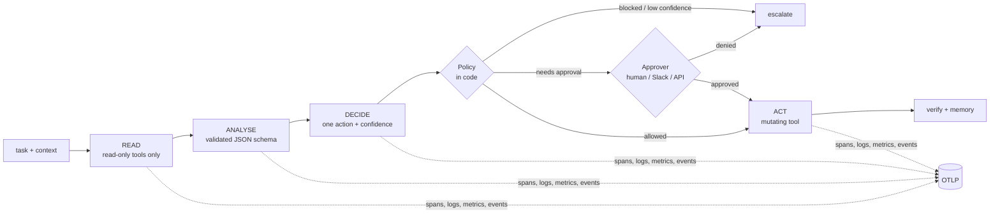

# agent-harness-sdk


**A base SDK for building production agents that read, analyse, decide and act, with OpenTelemetry built in.**
DeepSeek is the default model, but any OpenAI-compatible model or LangChain chat model works. You can use it
on its own, or bring its tools and guardrails into LangChain, LangGraph, CrewAI, LlamaIndex, the OpenAI
Agents SDK or any MCP client.

It is meant to be a starting point you take and change. Write your domain tools, add your rules, put a small
wrapper around it, and you have a product. The repo includes one as a worked example:
**[Incident Commander](examples/incident_commander)**, an AI incident manager that receives Alertmanager alerts,
investigates, assigns a severity, rolls back with a human's approval and writes the postmortem draft.

```
pip install "agent-harness-sdk[all] @ git+https://github.com/debanjan0212/agent-harness-sdk"
agent-harness doctor     # shows what's configured and sends a test span, log and metric
```

It is not on PyPI yet, so install it from GitHub as above, or clone the repo (see [Start here](#start-here)).

## Start here

This section is written for anyone. Go step by step and stop at the step you need. Everything works offline first, so you can try it before you have any keys.

### What you need

| What you want to do | What you need |
|---|---|
| **Try it**: the examples and the Incident Commander demo | Python 3.11 or newer, Git. No API key: everything has an offline mode. |
| **Use a real AI model** | a DeepSeek API key from [platform.deepseek.com](https://platform.deepseek.com) (API keys page), or a key for any OpenAI-compatible provider, or [Ollama](https://ollama.com) on your machine (free) |
| **See traces, logs and metrics in Grafana** on your laptop | Docker with Docker Compose |
| **Investigate your real systems** | Prometheus and Loki URLs that can be reached from where the agent runs |
| **Act through Harness.io pipelines** | a Harness account, an API token, your organisation and project IDs, and Docker (Harness's MCP server runs in a container) |
| **Send messages to Slack** | a Slack incoming webhook URL (any Slack-compatible webhook works) |
| **Run Incident Commander on Kubernetes** | Helm, a container registry, and any cluster: EKS, GKE, AKS, bare metal or kind |

### Step 1: install and try it (5 minutes, no keys)

```bash
git clone https://github.com/debanjan0212/agent-harness-sdk.git
cd agent-harness-sdk
python3 -m venv .venv && source .venv/bin/activate      # on Windows use WSL2
pip install -e ".[all,dev]"

agent-harness doctor                                     # what it found: model, telemetry, installed frameworks
python examples/quickstart.py                            # the smallest agent, end to end
cd examples && python -m incident_commander demo --scenario bad-deploy --approve ask
```

The last command plays a real incident: an alert comes in, the agent investigates, decides on a rollback and **asks you** to approve it. Try `--scenario db-pool` (no safe fix, so it pages a human) and `--scenario injection` (a log line tries to trick the agent; it refuses).

To use the SDK inside your own project instead of this repo:

```bash
pip install "agent-harness-sdk[all] @ git+https://github.com/debanjan0212/agent-harness-sdk"
```

### Step 2: keep your settings in one file

```bash
cp .env.example .env            # fill in only what you have; leave the rest empty
set -a; source .env; set +a     # load it into this terminal (do this in every new terminal)
agent-harness doctor            # confirm it picked up your settings
```

`.env` is in `.gitignore`, so your keys are never committed.

### Step 3: connect an AI model

| Provider | What to set |
|---|---|
| **DeepSeek** (default) | `DEEPSEEK_API_KEY`. Optional: `DEEPSEEK_MODEL` (default `deepseek-flash`) |
| **OpenAI, or any OpenAI-compatible API** (Groq, OpenRouter, Together, vLLM, LiteLLM...) | `AGENT_MODEL_PROVIDER=openai-compatible`, `AGENT_MODEL`, `AGENT_MODEL_BASE_URL`, `AGENT_MODEL_API_KEY`, and build the model with `model_from_env()` |
| **Ollama** (free, runs locally) | as above, with `AGENT_MODEL_BASE_URL=http://localhost:11434/v1` and no key |
| **Anthropic, Bedrock, Vertex, Azure OpenAI** | install that provider's LangChain package and pass it in: `LangChainChatModel(ChatAnthropic(...))` |

The model must support tool calling. Incident Commander uses DeepSeek as soon as `DEEPSEEK_API_KEY` is set, and its offline playbook otherwise.

### Step 4: see the telemetry in Grafana (on your laptop)

```bash
docker compose --env-file .env -f deploy/docker-compose.yaml up --build     # or: make up
```

This starts Incident Commander and Grafana's all-in-one LGTM image (OpenTelemetry Collector, Tempo, Loki and Prometheus). Then:

1. Open **http://localhost:8080/docs** and send a test alert with `POST /webhooks/alertmanager`, or use the `curl` in the [Incident Commander README](examples/incident_commander/README.md).
2. Approve it: `GET /approvals`, then `POST /incidents/<id>/approve`.
3. Open Grafana at **http://localhost:3000** (user `admin`, password `admin`). Go to Explore and pick Tempo for traces, Loki for logs or Prometheus for metrics. Data shows up within a minute.

To send telemetry from your own app or another backend, set `OTEL_EXPORTER_OTLP_ENDPOINT` to any OTLP/HTTP endpoint: `http://localhost:4318` for the stack above, or your OpenTelemetry Collector, Grafana Alloy, the Datadog Agent with OTLP turned on, Honeycomb or Elastic. If your vendor needs a key, put it in `OTEL_EXPORTER_OTLP_HEADERS` (for example `x-honeycomb-team=<key>`).

### Step 5: connect your tools

| Tool | What you need | What to set |
|---|---|---|
| **Prometheus** | its URL, reachable from where the agent runs | `PROMETHEUS_URL`, e.g. `http://prometheus:9090` |
| **Loki** | its URL | `LOKI_URL`, e.g. `http://loki:3100` |
| **Slack** | an incoming webhook (Slack → Apps → Incoming Webhooks) | `NOTIFY_WEBHOOK_URL` |
| **Harness.io** | an API token and your IDs, see below | `HARNESS_API_KEY`, `HARNESS_DEFAULT_ORG_ID`, `HARNESS_DEFAULT_PROJECT_ID`, `HARNESS_ROLLBACK_PIPELINE` |

Managed Prometheus services that need sign-in (Amazon Managed Prometheus, Google Managed Prometheus, Grafana Cloud) need an auth proxy in front, for example `aws-sigv4-proxy`.

**Setting up Harness.io:**

1. In Harness, open your profile, go to **API Keys**, create an API key, then create a **token** under it. It looks like `pat.<account>.<id>.<secret>`; the SDK reads your account ID from it.
2. Copy the **identifiers** (not the display names) of your organisation and project from their settings pages.
3. The user who owns the token needs permission to **view and execute pipelines** in that project.
4. For rollbacks, create a pipeline (default identifier `rollback`) with three runtime pipeline variables: `service`, `version` and `environment`. The agent fills them in and runs it, always after approval.
5. Reading through Harness's official MCP server needs Docker, because it runs the `harness/mcp-server` image. See [`examples/frameworks/mcp_harness.py`](examples/frameworks/mcp_harness.py).

To make Incident Commander use these real tools instead of the demo data, set `IC_SOURCE=live`.

### Step 6: run Incident Commander on Kubernetes (EKS, GKE, AKS, bare metal)

Your cluster needs a default StorageClass for the 1 GiB volume (or add `--set persistence.enabled=false`).

```bash
docker build -t <your-registry>/incident-commander:0.1.0 . && docker push <your-registry>/incident-commander:0.1.0

kubectl create namespace incident-commander
kubectl -n incident-commander create secret generic incident-commander \
  --from-literal=DEEPSEEK_API_KEY=<key> \
  --from-literal=HARNESS_API_KEY=<token> --from-literal=HARNESS_DEFAULT_ORG_ID=<org> --from-literal=HARNESS_DEFAULT_PROJECT_ID=<project>

helm install ic deploy/helm/incident-commander -n incident-commander \
  --set image.repository=<your-registry>/incident-commander --set image.tag=0.1.0 \
  --set env.PROMETHEUS_URL=http://<prometheus>:9090 --set env.LOKI_URL=http://<loki>:3100 \
  --set env.OTEL_EXPORTER_OTLP_ENDPOINT=http://<collector>:4318
```

Then send alerts to it. Add a webhook receiver to your Alertmanager with the URL
`http://ic.incident-commander.svc/webhooks/alertmanager`. With the Prometheus Operator you can use `--set alertmanager.enabled=true` instead, but by default the operator only routes alerts from the same namespace to it.

Approvals: `kubectl -n incident-commander port-forward svc/ic 8080:80`, then use http://localhost:8080/docs.

### All settings

| Setting | What it does |
|---|---|
| `DEEPSEEK_API_KEY`, `DEEPSEEK_MODEL`, `DEEPSEEK_BASE_URL` | the default model |
| `AGENT_MODEL_PROVIDER`, `AGENT_MODEL`, `AGENT_MODEL_BASE_URL`, `AGENT_MODEL_API_KEY` | any other model, through `model_from_env()` |
| `OTEL_EXPORTER_OTLP_ENDPOINT`, `OTEL_EXPORTER_OTLP_HEADERS` | where telemetry goes; leave the endpoint empty for console only |
| `OTEL_SERVICE_NAME`, `DEPLOYMENT_ENVIRONMENT` | how the service shows up in your telemetry |
| `HARNESS_API_KEY`, `HARNESS_DEFAULT_ORG_ID`, `HARNESS_DEFAULT_PROJECT_ID`, `HARNESS_ROLLBACK_PIPELINE`, `HARNESS_BASE_URL` | Harness.io |
| `PROMETHEUS_URL`, `LOKI_URL`, `NOTIFY_WEBHOOK_URL` | the observability and notification tools |
| `LOG_LEVEL`, `LOG_FORMAT` | Incident Commander logs: `TRACE` to `FATAL`; `text` or `json` |
| `IC_SOURCE`, `IC_SCENARIO`, `IC_DB`, `PORT`, `HOST` | Incident Commander: `live` or demo data, which demo, SQLite file, HTTP port, listen address (`0.0.0.0`; set `127.0.0.1` to keep it local) |

### Something not working?

| Problem | What to check |
|---|---|
| `agent-harness: command not found` | activate the virtualenv: `source .venv/bin/activate` |
| `doctor` says no model is configured | load your `.env` in this terminal: `set -a; source .env; set +a` |
| model error 401 or 402 | 401 means a wrong key; 402 from DeepSeek means the account has no balance |
| nothing in Grafana | the compose stack is running and `OTEL_EXPORTER_OTLP_ENDPOINT` is set; wait a minute |
| installing CrewAI breaks other packages | CrewAI pins older `mcp` and `openai`; install it in its own virtualenv (`make crewai`) |
| Harness returns 401 or 404 | the token is valid, and the org and project are identifiers, not display names |

## What every agent gets



| Stage | What the harness does for you |
|---|---|
| **READ** | The model only sees read-only tools, so it can't change anything while it's still investigating. Tool output is redacted (tokens, keys, passwords) and scanned for prompt injection. There's a step budget, a tool-call budget, a token budget and a time budget. |
| **ANALYSE** | The model's answer is checked against your Pydantic schema. Bad JSON gets one self-correction round. |
| **DECIDE** | The model picks exactly one action, with arguments, a confidence and a risk level. The arguments are checked against the tool's own signature. |
| **Policy** | This part is plain code, not prompt text: minimum confidence, a deny list, dry-run, a cap on actions per run, *block mutation if injection was seen*, plus your own rule functions. |
| **Approval** | `AutoApprove`, `DenyAll`, `CallbackApprover(fn)`, or `PendingApprovals` (for a web API / Slack button). Denied or timed out → escalation. |
| **ACT** | Runs the tool with a timeout, then your `verify` hook. Every outcome is recorded: `done`, `failed`, `denied`, `dry_run`, `escalated`. |

Each stage is a method (`read`, `analyse`, `decide`, `act`) you can override in a subclass.

## Your first agent

```python
from agent_harness_sdk import Agent, CallbackApprover, DeepSeekModel, setup_telemetry, tool

setup_telemetry("disk-janitor")  # console logs; set OTEL_EXPORTER_OTLP_ENDPOINT to ship MELT


@tool()
def disk_usage(host: str) -> dict:
    """Disk usage per mount on a host."""
    return {"/var/log": "97%"}


@tool(mutating=True)  # mutating tools need approval and are hidden during READ
def rotate_logs(host: str) -> dict:
    """Rotate and compress logs on a host."""
    return {"freed_gb": 12.4}


agent = Agent(
    "disk-janitor",
    model=DeepSeekModel(),
    tools=[disk_usage, rotate_logs],
    approver=CallbackApprover(lambda req: input("approve %s? " % req.action) == "y"),
)
run = agent.run("web-1: /var/log above 95%")
print(run.status, run.analysis.summary, run.outcome.status)
```

No API key? `python examples/quickstart.py` runs the same agent with a `ScriptedModel`, so you can try it offline,
and the same model is what makes the tests deterministic.

## MELT: metrics, events, logs, traces — automatic

`setup_telemetry()` wires the OpenTelemetry SDK once. When `OTEL_EXPORTER_OTLP_ENDPOINT` is set, everything below
goes to `/v1/traces`, `/v1/metrics` and `/v1/logs` over OTLP/HTTP. That works with any collector: Grafana, Datadog,
Honeycomb, New Relic, Elastic, Dynatrace, Jaeger.

| Signal | What you get | Names |
|---|---|---|
| **Traces** | One span tree per run, using GenAI semantic conventions | `invoke_agent {agent}` → `agent.stage {stage}` → `chat {model}` / `execute_tool {tool}` |
| **Metrics** | Token use and latency per model, tool, stage, decision and guardrail | `gen_ai.client.token.usage`, `gen_ai.client.operation.duration`, `gen_ai.execute_tool.duration`, `gen_ai.invoke_agent.duration`, `agent.runs`, `agent.tool.calls`, `agent.decisions`, `agent.guardrail.events`, `agent.stage.duration` |
| **Logs** | OTel log records with `trace_id` / `span_id`, at every level | TRACE(1) DEBUG(5) INFO(9) WARN(13) ERROR(17) FATAL(21) |
| **Events** | Log records with an `event_name`, also passed to your hooks | `agent.run.start`, `agent.stage.start`, `agent.observation`, `agent.analysis`, `agent.decision`, `agent.approval.requested`, `agent.approval`, `agent.action`, `agent.verify`, `agent.guardrail`, `agent.run.end` |

### Logging rules (enforced)

```python
from agent_harness_sdk import get_logger

log = get_logger(__name__)

log.trace("raw model reply %s", reply)  # TRACE = 5, below DEBUG
log.debug("calling %s with %d args", tool, len(args))
log.info("incident %s opened", iid, service="checkout")  # keyword args become OTel attributes
log.warning("budget at %d%%", pct)
log.error("rollback failed: %s", err, incident_id=iid)
log.exception("unexpected error")  # keeps the traceback
log.fatal("cannot reach the model provider")
log.event("deploy.detected", "new version %s", v, version=v)  # OTel event (log record with event_name)
```

* **No f-strings, anywhere.** `tests/test_no_fstrings.py` scans every file in the repo and fails the build if it
  finds one, and ruff's `G` rules reject `.format()` and `%` formatting done inside a log call. Arguments are passed
  separately, so they're only formatted if the record is actually emitted, and the template stays the same for
  every occurrence, which keeps log search and grouping working.
* Console output is either `text` (human readable) or `json` (one OTel-shaped record per line: `timestamp`,
  `severity_text`, `severity_number`, `body`, `attributes`, `trace_id`, `span_id`, `resource`).
  Pick it with `setup_telemetry(console="json")` or `LOG_FORMAT=json` in the example app.
* Noisy libraries (httpx, httpcore, urllib3, mcp, asyncio) are held at WARN so your own logs stay readable.

## Use it with any framework

| Framework | Install | One line |
|---|---|---|
| LangChain | `[langchain]` | `to_langchain_tools(tools)`, `agent_as_tool(agent)`, `LangChainChatModel(any_lc_chat_model)` |
| LangGraph | `[langgraph]` | `build_graph(agent, approval="interrupt")`: the four stages as graph nodes, pauses with `interrupt()` for a human |
| CrewAI | `[crewai]` *(own env)* | `to_crewai_tools(tools)` |
| LlamaIndex | `[llamaindex]` | `to_llamaindex_tools(tools)` |
| OpenAI Agents SDK | `[openai-agents]` | `to_openai_agents_tools(tools, include_mutating=True, approver=...)` |
| MCP (in) | `[mcp]` | `async with MCPToolset(server) as ts: Agent(tools=ts.tools)`: any MCP server becomes tools. `readOnlyHint` decides what counts as read-only. |
| MCP (out) | `[mcp]` | `serve_mcp(tools).run()` or `agent-harness serve-mcp my_module:TOOLS`: use your tools from Claude, Cursor, VS Code |

Adapted tools keep the harness guarantees: a span, metrics, secret redaction, the injection check and
the approval gate for mutating tools. Mutating tools are left out unless you pass `include_mutating=True`.

Examples are in [`examples/frameworks/`](examples/frameworks).

> CrewAI pins `mcp<2` and `openai<3`, so install the `crewai` extra in its own virtualenv. CI tests it in a separate job.

## Models

| Model | How |
|---|---|
| DeepSeek (default) | `DeepSeekModel()` reads `DEEPSEEK_API_KEY`, `DEEPSEEK_MODEL` (default `deepseek-flash`) and `DEEPSEEK_BASE_URL`. `thinking=True` turns on reasoning mode. Reasoning text is recorded but never sent back to the API. |
| Any OpenAI-compatible API | `OpenAICompatibleModel(model, base_url, api_key)`, which covers OpenAI, Azure OpenAI, Groq, Together, OpenRouter, vLLM, Ollama and LiteLLM proxy |
| Anything LangChain supports | `LangChainChatModel(ChatAnthropic(...))`, Bedrock, Vertex, ... |
| From env | `model_from_env()` reads `AGENT_MODEL_PROVIDER=deepseek|openai-compatible`, `AGENT_MODEL`, `AGENT_MODEL_BASE_URL`, `AGENT_MODEL_API_KEY` |
| Offline / tests | `ScriptedModel(fn)` |

Retries on 408/409/429/5xx (respecting `Retry-After`), JSON mode for structured stages, and token usage on every span.

## Harness, both meanings

1. **The harness** is this runtime: stages, policy, approvals, budgets, memory, hooks, telemetry.
2. **Harness.io** comes with its own tool pack:
   * `harness_tools()`: REST tools `harness_recent_executions`, `harness_execution_status` (read) and
     `harness_trigger_pipeline`, `harness_rollback` (mutating, approval required).
     Env: `HARNESS_API_KEY` (a `pat.<account>.<id>.<secret>` token; the account is read from it),
     `HARNESS_DEFAULT_ORG_ID`, `HARNESS_DEFAULT_PROJECT_ID`, `HARNESS_ROLLBACK_PIPELINE`.
   * `harness_mcp_server()` starts Harness's official MCP server (`harness/mcp-server`, Docker, stdio), and
     `HARNESS_MCP_READ_ONLY` lists which of its tools the agent may use while reading.
     See [`examples/frameworks/mcp_harness.py`](examples/frameworks/mcp_harness.py).

Other packs: `prometheus_tools()` (PromQL), `loki_tools()` (LogQL with pattern summaries, so a thousand lines become
the top patterns), `notify_tools()` (Slack-compatible webhook).

## Run a fleet under Themis

[Themis](https://github.com/debanjan0212/themis-agent-sre) is an SRE control plane for agent fleets. It reads the
OpenTelemetry the harness already sends, gives every agent an error budget, and moves an agent that spends it
too fast from autonomous to supervised to suspended. Point the exporter at it to be watched; add two lines to be
governed:

```python
from agent_harness_sdk import ThemisApprover, ThemisGate, ThemisPolicy

gate = ThemisGate(os.environ["THEMIS_URL"], os.environ["THEMIS_INGEST_KEY"]).start()
agent = Agent("deployer", model=..., tools=[...], policy=ThemisPolicy(gate=gate), approver=ThemisApprover(gate))
```

| Themis says | What the harness does |
|---|---|
| autonomous | your `Policy` decides, as without Themis |
| supervised | every action waits for a person in the Themis dashboard, even one your `Policy` lets run alone |
| suspended | the agent still reads and analyses; every action it proposes goes to a person instead |
| tool outside the agent's allow-list | blocked and reported; five reports in five minutes suspend the agent |
| tool quarantined | blocked until the quarantine ends |

`ThemisPolicy` takes every `Policy` setting (`ThemisPolicy(gate=gate, min_confidence=0.8, rules=[...])`). The gate
refreshes a snapshot every second in the background, so a check costs nothing and agents keep working on the last
snapshot if Themis is briefly down. Approvals fail closed: no answer is a no. Each block is recorded as a denied
tool span, so Themis names the agent as the cause of the failed run. `tests/test_themis.py` covers each row of the
table; Themis's own ecosystem tests run the same classes against the real control plane.

## Wrap it into your own product

[`examples/wrap_any_app.py`](examples/wrap_any_app.py) is the pattern in about 80 lines:

1. **Domain schema**: subclass `Analysis` with your fields (`severity`, `monthly_waste_usd`, ...).
2. **Domain tools**: `@tool()` for reads, `@tool(mutating=True)` for changes.
3. **Domain rules**: plain functions in `Policy(rules=[...])`, e.g. *"no rollback without a recent deploy"*.
4. **Approver**: whatever fits your app: CLI prompt, Slack button, ticket, web endpoint (`PendingApprovals`).
5. **Hooks**: every `AgentEvent` goes to your timeline, UI stream or audit log.
6. **Entry point**: an HTTP endpoint, queue worker, cron job or CLI that calls `await agent.arun(...)`.

### The worked example: Incident Commander

```
cd examples
python -m incident_commander demo --scenario bad-deploy   # SEV1 → rollback (asks you first)
python -m incident_commander demo --scenario db-pool      # SEV2 → no safe fix → pages on-call
python -m incident_commander demo --scenario injection    # poisoned log line → flagged, no action
python -m incident_commander serve                        # HTTP API on :8080, /docs for Swagger
```

It adds a SQLite incident store with a timeline, severity rules, a domain policy rule, product metrics
(`incidents.opened`, `incidents.closed`, `incidents.time_to_mitigate`), an Alertmanager webhook, an approval API and
a postmortem draft. Details in [its README](examples/incident_commander/README.md).

## Develop

```
make dev      # editable install with every extra except crewai
make check    # ruff lint + format check + tests (the f-string scan is one of the tests)
make crewai   # CrewAI adapter test in its own venv
```

## Licence

MIT © Debanjan Das
