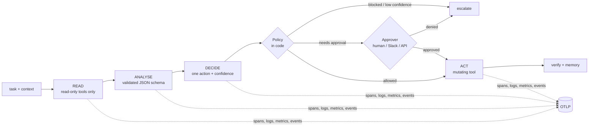

# agent-harness-sdk

**A base SDK for building production agents that read, analyse, decide and act, with OpenTelemetry built in.**
DeepSeek is the default model, but any OpenAI-compatible model or LangChain chat model works. You can use it
on its own, or bring its tools and guardrails into LangChain, LangGraph, CrewAI, LlamaIndex, the OpenAI
Agents SDK or any MCP client.

It is meant to be a starting point you take and change. Write your domain tools, add your rules, put a small
wrapper around it, and you have a product. The repo includes one as a worked example:
**[Incident Commander](examples/incident_commander)**, an AI incident manager that receives Alertmanager alerts,
investigates, assigns a severity, rolls back with a human's approval and writes the postmortem draft.

```
pip install "agent-harness-sdk[all]"     # or just: pip install agent-harness-sdk
agent-harness doctor                     # shows what's configured and sends a test span, log and metric
```

## What every agent gets



| Stage | What the harness does for you |
|---|---|
| **READ** | The model only sees read-only tools, so it can't change anything while it's still investigating. Tool output is redacted (tokens, keys, passwords) and scanned for prompt injection. There's a step budget, a tool-call budget, a token budget and a time budget. |
| **ANALYSE** | The model's answer is checked against your Pydantic schema. Bad JSON gets one self-correction round. |
| **DECIDE** | The model picks exactly one action, with arguments, a confidence and a risk level. The arguments are checked against the tool's own signature. |
| **Policy** | This part is plain code, not prompt text: minimum confidence, a deny list, dry-run, a cap on actions per run, *block mutation if injection was seen*, plus your own rule functions. |
| **Approval** | `AutoApprove`, `DenyAll`, `CallbackApprover(fn)`, or `PendingApprovals` (for a web API / Slack button). Denied or timed out → escalation. |
| **ACT** | Runs the tool with a timeout, then your `verify` hook. Every outcome is recorded: `done`, `failed`, `denied`, `dry_run`, `escalated`. |

Each stage is a method (`read`, `analyse`, `decide`, `act`) you can override in a subclass.

## Quick start

```python
from agent_harness_sdk import Agent, CallbackApprover, DeepSeekModel, setup_telemetry, tool

setup_telemetry("disk-janitor")  # console logs; set OTEL_EXPORTER_OTLP_ENDPOINT to ship MELT


@tool()
def disk_usage(host: str) -> dict:
    """Disk usage per mount on a host."""
    return {"/var/log": "97%"}


@tool(mutating=True)  # mutating tools need approval and are hidden during READ
def rotate_logs(host: str) -> dict:
    """Rotate and compress logs on a host."""
    return {"freed_gb": 12.4}


agent = Agent(
    "disk-janitor",
    model=DeepSeekModel(),
    tools=[disk_usage, rotate_logs],
    approver=CallbackApprover(lambda req: input("approve %s? " % req.action) == "y"),
)
run = agent.run("web-1: /var/log above 95%")
print(run.status, run.analysis.summary, run.outcome.status)
```

No API key? `python examples/quickstart.py` runs the same agent with a `ScriptedModel`, so you can try it offline,
and the same model is what makes the tests deterministic.

## MELT: metrics, events, logs, traces — automatic

`setup_telemetry()` wires the OpenTelemetry SDK once. When `OTEL_EXPORTER_OTLP_ENDPOINT` is set, everything below
goes to `/v1/traces`, `/v1/metrics` and `/v1/logs` over OTLP/HTTP. That works with any collector: Grafana, Datadog,
Honeycomb, New Relic, Elastic, Dynatrace, Jaeger.

| Signal | What you get | Names |
|---|---|---|
| **Traces** | One span tree per run, using GenAI semantic conventions | `invoke_agent {agent}` → `agent.stage {stage}` → `chat {model}` / `execute_tool {tool}` |
| **Metrics** | Token use and latency per model, tool, stage, decision and guardrail | `gen_ai.client.token.usage`, `gen_ai.client.operation.duration`, `gen_ai.execute_tool.duration`, `gen_ai.invoke_agent.duration`, `agent.runs`, `agent.tool.calls`, `agent.decisions`, `agent.guardrail.events`, `agent.stage.duration` |
| **Logs** | OTel log records with `trace_id` / `span_id`, at every level | TRACE(1) DEBUG(5) INFO(9) WARN(13) ERROR(17) FATAL(21) |
| **Events** | Log records with an `event_name`, also passed to your hooks | `agent.run.start`, `agent.stage.start`, `agent.observation`, `agent.analysis`, `agent.decision`, `agent.approval.requested`, `agent.approval`, `agent.action`, `agent.verify`, `agent.guardrail`, `agent.run.end` |

### Logging rules (enforced)

```python
from agent_harness_sdk import get_logger

log = get_logger(__name__)

log.trace("raw model reply %s", reply)  # TRACE = 5, below DEBUG
log.debug("calling %s with %d args", tool, len(args))
log.info("incident %s opened", iid, service="checkout")  # keyword args become OTel attributes
log.warning("budget at %d%%", pct)
log.error("rollback failed: %s", err, incident_id=iid)
log.exception("unexpected error")  # keeps the traceback
log.fatal("cannot reach the model provider")
log.event("deploy.detected", "new version %s", v, version=v)  # OTel event (log record with event_name)
```

* **No f-strings, anywhere.** `tests/test_no_fstrings.py` scans every file in the repo and fails the build if it
  finds one, and ruff's `G` rules reject `.format()` and `%` formatting done inside a log call. Arguments are passed
  separately, so they're only formatted if the record is actually emitted, and the template stays the same for
  every occurrence, which keeps log search and grouping working.
* Console output is either `text` (human readable) or `json` (one OTel-shaped record per line: `timestamp`,
  `severity_text`, `severity_number`, `body`, `attributes`, `trace_id`, `span_id`, `resource`).
  Pick it with `setup_telemetry(console="json")` or `LOG_FORMAT=json` in the example app.
* Noisy libraries (httpx, httpcore, urllib3, mcp, asyncio) are held at WARN so your own logs stay readable.

## Use it with any framework

| Framework | Install | One line |
|---|---|---|
| LangChain | `[langchain]` | `to_langchain_tools(tools)`, `agent_as_tool(agent)`, `LangChainChatModel(any_lc_chat_model)` |
| LangGraph | `[langgraph]` | `build_graph(agent, approval="interrupt")`: the four stages as graph nodes, pauses with `interrupt()` for a human |
| CrewAI | `[crewai]` *(own env)* | `to_crewai_tools(tools)` |
| LlamaIndex | `[llamaindex]` | `to_llamaindex_tools(tools)` |
| OpenAI Agents SDK | `[openai-agents]` | `to_openai_agents_tools(tools, include_mutating=True, approver=...)` |
| MCP (in) | `[mcp]` | `async with MCPToolset(server) as ts: Agent(tools=ts.tools)`: any MCP server becomes tools. `readOnlyHint` decides what counts as read-only. |
| MCP (out) | `[mcp]` | `serve_mcp(tools).run()` or `agent-harness serve-mcp my_module:TOOLS`: use your tools from Claude, Cursor, VS Code |

Adapted tools keep the harness guarantees: a span, metrics, secret redaction, the injection check and
the approval gate for mutating tools. Mutating tools are left out unless you pass `include_mutating=True`.

Examples are in [`examples/frameworks/`](examples/frameworks).

> CrewAI pins `mcp<2` and `openai<3`, so install the `crewai` extra in its own virtualenv. CI tests it in a separate job.

## Models

| Model | How |
|---|---|
| DeepSeek (default) | `DeepSeekModel()` reads `DEEPSEEK_API_KEY`, `DEEPSEEK_MODEL` (default `deepseek-flash`) and `DEEPSEEK_BASE_URL`. `thinking=True` turns on reasoning mode. Reasoning text is recorded but never sent back to the API. |
| Any OpenAI-compatible API | `OpenAICompatibleModel(model, base_url, api_key)`, which covers OpenAI, Azure OpenAI, Groq, Together, OpenRouter, vLLM, Ollama and LiteLLM proxy |
| Anything LangChain supports | `LangChainChatModel(ChatAnthropic(...))`, Bedrock, Vertex, ... |
| From env | `model_from_env()` reads `AGENT_MODEL_PROVIDER=deepseek|openai-compatible`, `AGENT_MODEL`, `AGENT_MODEL_BASE_URL`, `AGENT_MODEL_API_KEY` |
| Offline / tests | `ScriptedModel(fn)` |

Retries on 408/409/429/5xx (respecting `Retry-After`), JSON mode for structured stages, and token usage on every span.

## Harness, both meanings

1. **The harness** is this runtime: stages, policy, approvals, budgets, memory, hooks, telemetry.
2. **Harness.io** comes with its own tool pack:
   * `harness_tools()`: REST tools `harness_recent_executions`, `harness_execution_status` (read) and
     `harness_trigger_pipeline`, `harness_rollback` (mutating, approval required).
     Env: `HARNESS_API_KEY` (a `pat.<account>.<id>.<secret>` token; the account is read from it),
     `HARNESS_DEFAULT_ORG_ID`, `HARNESS_DEFAULT_PROJECT_ID`, `HARNESS_ROLLBACK_PIPELINE`.
   * `harness_mcp_server()` starts Harness's official MCP server (`harness/mcp-server`, Docker, stdio), and
     `HARNESS_MCP_READ_ONLY` lists which of its tools the agent may use while reading.
     See [`examples/frameworks/mcp_harness.py`](examples/frameworks/mcp_harness.py).

Other packs: `prometheus_tools()` (PromQL), `loki_tools()` (LogQL with pattern summaries, so a thousand lines become
the top patterns), `notify_tools()` (Slack-compatible webhook).

## Wrap it into your own product

[`examples/wrap_any_app.py`](examples/wrap_any_app.py) is the pattern in about 80 lines:

1. **Domain schema**: subclass `Analysis` with your fields (`severity`, `monthly_waste_usd`, ...).
2. **Domain tools**: `@tool()` for reads, `@tool(mutating=True)` for changes.
3. **Domain rules**: plain functions in `Policy(rules=[...])`, e.g. *"no rollback without a recent deploy"*.
4. **Approver**: whatever fits your app: CLI prompt, Slack button, ticket, web endpoint (`PendingApprovals`).
5. **Hooks**: every `AgentEvent` goes to your timeline, UI stream or audit log.
6. **Entry point**: an HTTP endpoint, queue worker, cron job or CLI that calls `await agent.arun(...)`.

### The worked example: Incident Commander

```
cd examples
python -m incident_commander demo --scenario bad-deploy   # SEV1 → rollback (asks you first)
python -m incident_commander demo --scenario db-pool      # SEV2 → no safe fix → pages on-call
python -m incident_commander demo --scenario injection    # poisoned log line → flagged, no action
python -m incident_commander serve                        # HTTP API on :8080, /docs for Swagger
```

It adds a SQLite incident store with a timeline, severity rules, a domain policy rule, product metrics
(`incidents.opened`, `incidents.closed`, `incidents.time_to_mitigate`), an Alertmanager webhook, an approval API and
a postmortem draft. Details in [its README](examples/incident_commander/README.md).

## Run and deploy

| Where | How |
|---|---|
| Laptop, with dashboards | `docker compose -f deploy/docker-compose.yaml up --build`: Incident Commander + Grafana LGTM (OTel collector, Tempo, Loki, Prometheus). Grafana on :3000. |
| Any Kubernetes (EKS, GKE, AKS, OpenShift, k3s, bare metal) | `helm install ic deploy/helm/incident-commander --set alertmanager.enabled=true` |
| Your own app | `pip install agent-harness-sdk` and import it |

## Configuration

| Variable | Used for |
|---|---|
| `DEEPSEEK_API_KEY`, `DEEPSEEK_MODEL`, `DEEPSEEK_BASE_URL` | Default model |
| `AGENT_MODEL_PROVIDER`, `AGENT_MODEL`, `AGENT_MODEL_BASE_URL`, `AGENT_MODEL_API_KEY` | `model_from_env()` |
| `OTEL_EXPORTER_OTLP_ENDPOINT`, `OTEL_SERVICE_NAME`, `DEPLOYMENT_ENVIRONMENT` | Telemetry |
| `HARNESS_API_KEY`, `HARNESS_DEFAULT_ORG_ID`, `HARNESS_DEFAULT_PROJECT_ID`, `HARNESS_BASE_URL` | Harness.io pack and MCP server |
| `PROMETHEUS_URL`, `LOKI_URL`, `NOTIFY_WEBHOOK_URL` | Observability packs |

Copy [`.env.example`](.env.example) to get started.

## Develop

```
make dev      # editable install with every extra except crewai
make check    # ruff lint + format check + tests (the f-string scan is one of the tests)
make crewai   # CrewAI adapter test in its own venv
```

## Licence

MIT © Debanjan Das
